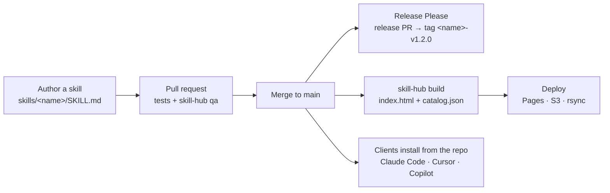

# skill-hub

**A starter kit for running your own agent-skill marketplace.** Create a repository from it, fill in one config file, add your skills, and you get a QA-gated, versioned catalog that installs into Claude Code, Cursor and GitHub Copilot, plus a static marketplace page on the host you choose.

skill-hub is not a marketplace. It hosts nothing and lists nobody's skills. It is the scaffolding for *your* hub: your team's skills, in your repository, under your name.

> [!NOTE]
> **Is this your hub?** This README belongs to you: replace it with your hub's own front page. Kit updates never touch it. The kit's full manual lives in [KIT.md](KIT.md).

## Why

Teams that write agent skills tend to end up with skills scattered across personal folders, copied by hand into each client, broken silently by a bad frontmatter key, and with no version history or way to browse them. skill-hub gives those skills one home with the guardrails a shared codebase would have:

- **One folder per skill.** Every skill is a `SKILL.md` under `skills/` that follows the [Agent Skills specification](https://agentskills.io/specification), so it works in any client that reads the spec.
- **QA on every pull request.** `skill-hub qa` rejects invalid frontmatter, names that don't match their folder, bad versions, Python that doesn't compile and committed secrets. Findings never print the offending value, so a leaked key doesn't land in your CI logs.
- **A version per skill.** Conventional commits (`feat:`, `fix:`) drive [Release Please](https://github.com/googleapis/release-please), which bumps each skill's version, writes its changelog and tags its release.
- **A marketplace page.** A static, self-contained page with a card and copy-ready install commands for every skill, plus a machine-readable `catalog.json`. Restyle it from config or bring your own Jinja2 theme.
- **Deploy anywhere.** CI publishes the page on every push to `main`: GitHub Pages, an S3-compatible bucket (AWS, Cloudflare R2, MinIO, B2) or your own server over rsync. Adding another target takes one workflow file.
- **Install from any major client.** Claude Code, Cursor and Copilot each install straight from the hub's GitHub repository, from manifests the kit generates. Nothing needs publishing to a registry.
- **Kit updates as pull requests.** When the kit ships a release, your hub gets a PR with a three-way merge that keeps your changes. You review it like any other PR.

All of it runs on Python and GitHub Actions, with [uv](https://docs.astral.sh/uv/) as the only thing you install. No Node toolchain.

## How it works



Everything that identifies your hub lives in `hub.yml`. Every command reads its identity from there, so adopting the kit never means editing its code.

## Quick start

You need [uv](https://docs.astral.sh/uv/) (it fetches Python 3.11+ for you) and a GitHub repository with Actions enabled.

**1. Create your hub.** Click **Use this template** on this repository, or clone it into a new repository of your own. Then:

```bash
git clone https://github.com/<you>/<your-hub>.git
cd <your-hub>
uv sync
uv run skill-hub qa
```

A fresh copy passes with two warnings. Both are reminders to make the hub yours.

**2. Name it.** Edit `hub.yml`:

```yaml
hub:
  name: acme-skills              # lowercase letters, digits and single hyphens
  display_name: Acme Skills
  owner: Acme Platform Team
  description: Skills for Acme's coding agents.
  repo_url: https://github.com/acme/acme-skills
```

Then regenerate the client manifests with `uv run skill-hub manifests`.

**3. Add a skill.**

```bash
uv run skill-hub new-skill changelog-formatter
```

This creates `skills/changelog-formatter/SKILL.md`, registers it for releases and updates the manifests. Write your instructions, replace the placeholder description, and delete `skills/example-skill/` once you have real skills of your own. Run `uv run skill-hub qa` until it comes back clean.

**4. Turn on the GitHub side.**

- Settings → Actions → General → enable **Allow GitHub Actions to create and approve pull requests**. Release PRs and kit-update PRs both need it.
- Pick a deploy target in `hub.yml` (for the simplest option, set `deploy.target: github-pages` and set Settings → Pages → Source to **GitHub Actions**). See [Deploying the marketplace page](KIT.md#deploying-the-marketplace-page) for S3 and rsync.

**5. Push to `main`.** CI runs QA, builds the marketplace page, deploys it, and opens a release PR for your new skill. Merge that PR to cut the skill's first release.

To preview the page locally first:

```bash
uv run skill-hub build
python -m http.server -d site    # then open http://localhost:8000
```

## Installing skills from a hub

This is what the people who use your hub see. The marketplace page shows each command ready to copy, with your repository and hub name filled in.

**Claude Code**

```text
/plugin marketplace add <owner>/<repo>
/plugin install <skill>@<hub-name>
```

**GitHub Copilot** (and other agents through `--agent`)

```bash
gh skill install <owner>/<repo> <skill>@<skill>-v<version>
```

**Cursor:** Customize → Plugins → From GitHub Repository, then enter `<owner>/<repo>`.

Private hubs work too: every path uses the installer's existing git credentials. Details are in [Installing skills](KIT.md#installing-skills).

## Commands

| Command | What it does |
|---|---|
| `skill-hub qa` | Check `hub.yml` and every skill. `--strict` fails on warnings too |
| `skill-hub new-skill <name>` | Create a skill that already passes QA and register it for releases |
| `skill-hub manifests` | Regenerate the Claude Code and Cursor marketplace manifests |
| `skill-hub build` | Build the marketplace page and `catalog.json` into `site/` |
| `skill-hub deploy-config` | Print the deploy target and settings CI will use |
| `skill-hub update` | Merge the newest kit release into your hub (never commits). `--check` only reports |

Run each with `uv run`. Every QA check has an ID (H1, S4, R7...) listed in [QA checks](KIT.md#qa-checks).

## Staying up to date

Your hub records which kit release it came from in `.skill-hub/kit.yml`. Every Monday, the **Kit update** workflow checks for a newer release and, if there is one, opens a pull request that merges it in:

- Files you never touched take the kit's new version. Files only you changed stay as they are. Where both sides changed the same lines, you get ordinary git conflict markers to resolve on the PR branch.
- `README.md`, `skills/` and your release files are never touched.
- A new major version is never proposed automatically. You opt in.
- The updater that runs is the one already in your repository, locked by your `uv.lock`, never code from the release it is fetching.

The full rules, including the optional token that lets update PRs change workflow files, are in [Updating your hub](KIT.md#updating-your-hub).

## Documentation

[KIT.md](KIT.md) is the complete manual:

- [Writing a skill](KIT.md#writing-a-skill): the frontmatter rules QA enforces
- [Releasing a skill](KIT.md#releasing-a-skill): how commits become versions
- [Marketplace page](KIT.md#marketplace-page): the catalog format and custom themes
- [Deploying the marketplace page](KIT.md#deploying-the-marketplace-page): each target's settings, secrets and setup, and how to add your own
- [Updating your hub](KIT.md#updating-your-hub): update PRs, conflicts and tokens
- [QA checks](KIT.md#qa-checks): every check, its ID and its level

## Contributing

Issues and pull requests are welcome. Commits follow [Conventional Commits](https://www.conventionalcommits.org/), and before opening a PR, run:

```bash
uv run ruff check
uv run pytest
uv run skill-hub qa
```

CI runs all three on Python 3.11 and 3.14. See [Contributing](KIT.md#contributing) for more, and [Prior art](KIT.md#prior-art) for the projects skill-hub learned from.

## License

See [LICENSE](LICENSE).
